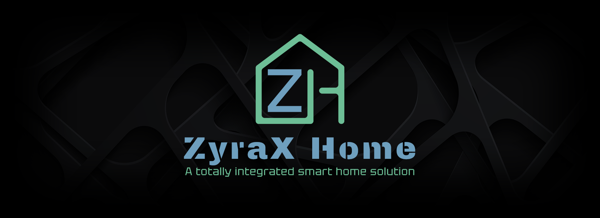
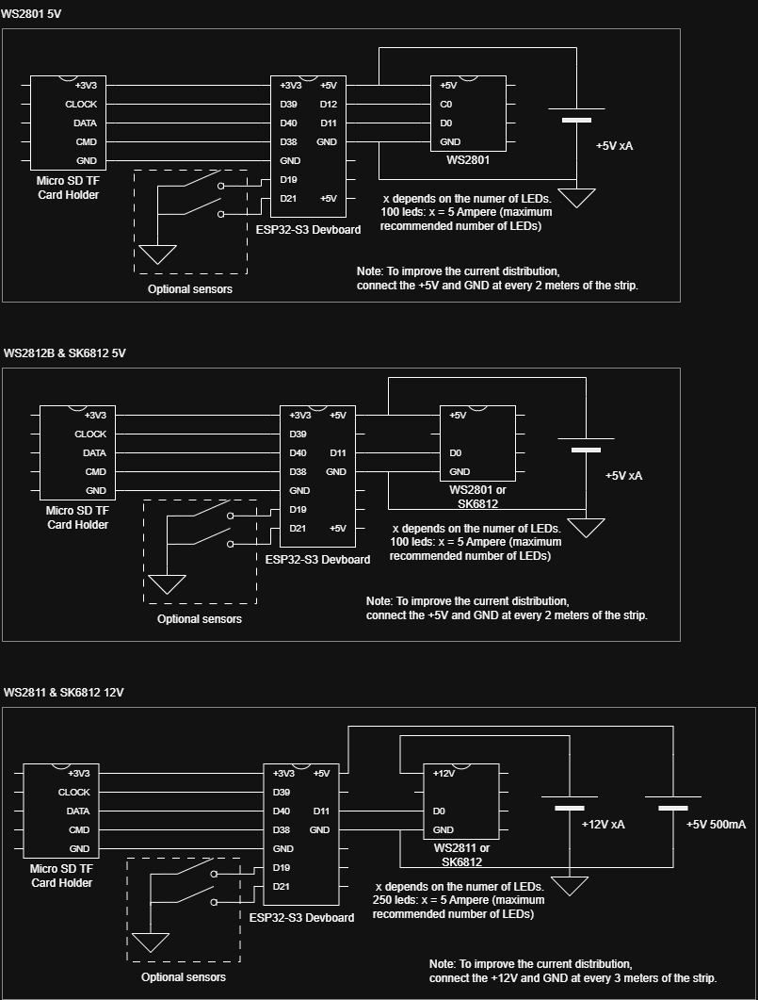

# ZyraX Home | RGBW LED strip controller

[ZyraX Home](https://www.zyraxhome.munkservices.com) is an open-source platform engineered as a unified smart home system. It provides centralized control and real-time monitoring of home electronics, integrates sensor data, and manages programmable LED lighting. The platform supports extensible modules and automation rules, enabling fine-grained control over connected devices.

See `documentation/images` for more product images.

> Note: For those who prefer not to program it themselves, plug-and-play solutions are also available for purchase on [ZyraX Home](https://www.zyraxhome.munkservices.com/order_products).

### Features

The ZyraX Home RGBW controller is in beta-stage development, with continuous improvements planned. See section `7.2 Roadmap` for a complete overview of upcoming features. Key features in version `0.9.0 Beta` include:

- **Easy network configuration through an access point**
- **Easy LED addressing configuration through a GUI**
- **Real-time LED coloring**
- **More than 16 fully customizable animations**
- **4 power animations**
- **10 color palettes**
- **Multiple addressable LED driver support. Supported models:**
    - [WS2801 5V](https://nl.aliexpress.com/item/32259735265.html)
    - [WS2812B 5V](https://nl.aliexpress.com/item/32476290984.html)
    - [WS2811 12V](https://nl.aliexpress.com/item/1005005217792268.html)
    - [SK6812 5V](https://nl.aliexpress.com/item/1005005824057524.html)
    - [SK6812 12V](https://nl.aliexpress.com/item/1005009607361396.html) (Recommended)
<!--
- **Multiple non-addressable LED strip support. Supported models:**
    - [5V non-addressable RGB LED strip](https://nl.aliexpress.com/item/1005005574408624.html)
    - [12V non-addressable RGBW LED strip](https://nl.aliexpress.com/item/32875911414.html)
    - [24V non-addressable RGBW LED strip](https://nl.aliexpress.com/item/32875911414.html)
    - [12V non-addressable RGBW-WW (White-Warm White) LED strip](https://nl.aliexpress.com/item/32875911414.html)
    - [24V non-addressable RGBW-WW (White-Warm White) LED strip](https://nl.aliexpress.com/item/32875911414.html)
    - [12V non-addressable White LED strip](https://nl.aliexpress.com/item/1005008309283782.html)
    - [24V non-addressable White LED strip](https://nl.aliexpress.com/item/1005008309283782.html)
-->
- **Local contact sensor support (e.g., for closet doors). Tested models:**
    - [MC-38 Wired Door Window Sensor](https://nl.aliexpress.com/item/1005007384403212.html)
    - Any wired sensor should work. Normally Open (NO) and Normally Closed (NC) can be configured at the device configuration.
- **Over-The-Air firmware updates:** LED strip firmware can be updated remotely
- **Compatible with automations:** See the automation features of the [main controller](https://github.com/LukedeMunk/zyrax-home-main-controller/releases) for more information.

### About the ZyraX Home platform

The ZyraX Home platform is designed for **modularity and extensibility**, allowing developers to integrate custom devices, extend automation logic, and interface with external APIs.

The vision of the ZyraX Home platform is to provide a high-end, fully integrated smart home experience. Every component, from lighting and sensors to automations and third-party devices/services, will work seamlessly together under a single platform, creating a unified, intelligent home environment. The system aims to combine luxury, flexibility, and advanced functionality, making it easy for users to manage and expand their smart home setup while ensuring reliability and performance.

This ZyraX Home RGBW led strip controller is custom made for fully integration in the ZyraX Home platform. The controller needs the main controller to be used. The controller supports numberous different ledstrips, from addressable RGBW strips to analogue white strips (see supported drivers and strips).

To be able to connect the kinds of led strips, a PCB is in development and will be available from version 1.0.0 or version 1.1.0. The PCB will have multiple terminals and voltage connections for a plug and play experience.

### Other ZyraX Home devices

The platform can integrate with other open-source components developed for the ZyraX Home ecosystem:

- [ZyraX Home | Main controller](https://github.com/LukedeMunk/zyrax-home-main-controller/releases)
- [ZyraX Home | RF & Zigbee bridge](https://github.com/LukedeMunk/zyrax-home-rf-zigbee-bridge/releases) (Unreleased, in development)
- [ZyraX Home | IP camera](https://github.com/LukedeMunk/zyrax-home-ip-camera/releases) (Unreleased, in development)
- [ZyraX Home | ElectriControl]() (Unreleased, in development)
- [ZyraX Home | iOS app](https://github.com/LukedeMunk/zyrax-home-ios-app/releases) (Unreleased, in development)

## 1. Bill of Materials

The bill of materials is presented below.

- 1x [ESP32-S3](https://www.espressif.com/en/products/socs/esp32-s3)
- 1x Supported addressable ledstrip
- 1x xA yV adapter (x depends on the length of the LED strip, y depends on the LED driver)
- 1x 8 GB Micro SD
- Wires for power injection every 5 meters and sensors
- (optional) [MC-38 Wired Door Window Sensor](https://nl.aliexpress.com/item/1005007384403212.html)
- (optional) Other wired sensors

## 2. Compatible firmware of ZyraX Home main controller

The table below lists the compatible firmware versions for each version of the main controller.

| **Firmware version**        | **Compatible main controller versions** |
|-----------------------------|-----------------------------------------|
| [v0.9.0 Beta](https://github.com/LukedeMunk/zyrax-home-rgbw-led-strip-controller/releases) | [v0.9.0 Beta](https://github.com/LukedeMunk/zyrax-home-main-controller/releases/tag/v0.9.0_Beta) |

## 3. Getting Started

These instructions provide an overview for compiling and uploading the firmware to the ESP32-S3.

### 3.1 Wiring

Use the schematic to connect the LED strip and optional wired sensor to the ESP32-S3.

> Note: Keep in mind for long LED strips, to inject power at least every 5 meters. To improve power distribution and avoid damage.

### 3.2 How to upload with ESP Flash Download Tool (Recommended)

1. Connect the controller with a USB cable. Make sure that the cable supports data
transfer.
    - No connection? Try to install the [CP210x Windows Drivers](https://www.silabs.com/developer-tools/usb-to-uart-bridge-vcp-drivers?tab=downloads)
2. Download and unpack the [ESP Flash Download Tool](https://www.espressif.com/en/products/socs/esp32/resources) from the Espressif site
3. Launch the tool, options:
    - ChipType: `ESP32-S3`
    - WorkMode: `Factory`
    - LoadMode: `UART`
4. Disable LockSettings
5. Download Path Config:
    - Path_To_Firmware @ `0x10000`
6. SPI Flash Config:
    - SPI SPEED: `40MHz`
    - SPI MODE: `DIO`
7. Download Panel 1
    - Choose right COM port
    - BAUD: `921600`
8. Start download

### 3.3 Visual Studio Code with Arduino extension

1. Install [VS Code](https://code.visualstudio.com/download)
2. Follow this tutorial to setup [Arduino with ESP32](https://randomnerdtutorials.com/installing-the-esp32-board-in-arduino-ide-windows-instructions/)
3. Install the [Arduino extension](https://github.com/microsoft/vscode-arduino) (Navigate to `VS Code > Extensions`)
4. Put the external libraries in the folder `.../Documents/Arduino/libraries`
5. Open the `ZyraX_Home_RGBW_ledstrip_controller` folder in VS Code
6. Make sure the following board config is used (others are default):
    - Selected Board: `ESP32S3 Dev Module (esp32)`
    - Flash Size: `8MB (64Mb)`
    - Partition Scheme: `8M with spiffs (3MB APP/1.5MB SPIFFS)`
7. Connect the board to the PC
8. Compile and upload

## 4. Configure ledstrips in main controller

To add new [RGBW LED strip controllers](https://github.com/LukedeMunk/zyrax-home-rgbw-led-strip-controller/releases) to the system, please boot the LED controller (with a compatible firmware version) and connect it to the same network as the main controller.

At the configuration page -> Add device -> Choose device or choose `My accessory is not shown here` -> Configure options -> Configure LED addressing

## 5. Documentation

Several documentation files describe this project and system. The list of these files is provided below.

- [Circuit diagram](documentation/hardware/schematic_v0_1.png)

## 6. Troubleshooting

### 6.1 Known bugs

| **Bug**    | **Version**    | **Planned Fix Version**     |
|------------|----------------|-----------------------------|
| | v0.9.0 | v1.0.0 |

### 6.2 Errors

- No LEDs are on:
    - Configure right modelZXXXXXXXX

## 7. Remarks

### 7.1 Risk assessment

This security risk assessment evaluates potential threats and vulnerabilities related to the Zyrax Home application. The goal is to identify key risks, assess their impact and likelihood, and provide guidance on appropriate mitigation measures. This ensures the application remains secure and reliable for its users.

| **Threat** | **Effect** | **Vulnerability** | **Probability** | **Impact** | **Mitigation** |
|------------|------------|-------------------|-----------------|------------|----------------|
|     |      |     |       |       |         |

### 7.2 Roadmap

Below is a roadmap for the ZyraX Home RGBW LED strip controller, highlighting the key versions. Minor updates are not included, as listing every change would be impractical. This roadmap is intended as a brainstorming outline, and all features are subject to change. Any suggestions? Please contact Luke de Munk.

| **Version**   | **Expected release**  | **Key features**                      |
|-------------  |---------------------- |------------------------------------   |
| v0.9.0 Beta   | 11-2026               | First public release                                  |
| v1.0.0        | 2027                  | PCB design                                            |
|               |                       | Improved OTA update functionality                     |
|               |                       | Sender verification (by hash) for HTTPS commands      |
|               |                       | Added modes                                           |
|               |                       | Real-time LED strips synchronization                  |
| v1.1.0        | 2027                  | Automatic device configuration over bluetooth         |
| v1.2.0        | 2027                  | Real-time music visualizer modes                      |
| v1.3.0        | 2027                  | Custom LED strip mode creation                        |

## 8. Issues, recommendations, feedback & security reports

I truly appreciate the opportunity to resolve issues and receive feedback on my work. This is a one-person hobby project into which I've invested many hours. If you have any recommendations, tips, or feedback, please feel free to open an issue or contact me directly.

## 9. Contributing

When contributing to this repository, please read [CONTRIBUTING.md](CONTRIBUTING.md), [HTML/CSS/JavaScript conventions](documentation/software/HTML_CSS_JAVASCRIPT_CONVENTIONS.md) and [C/C++ conventions](documentation/software/CPP_CONVENTIONS.md).

## 10. Authors

* **Luke de Munk** - Project maintainer - [Munk IT](munkservices.com) | [LinkedIn](https://www.linkedin.com/in/luke-de-munk/)